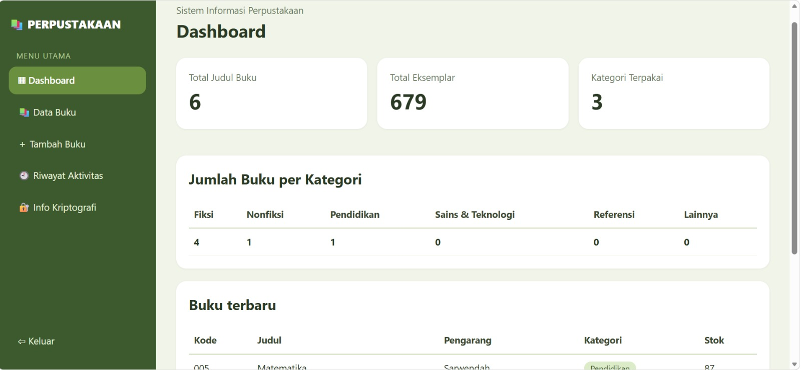
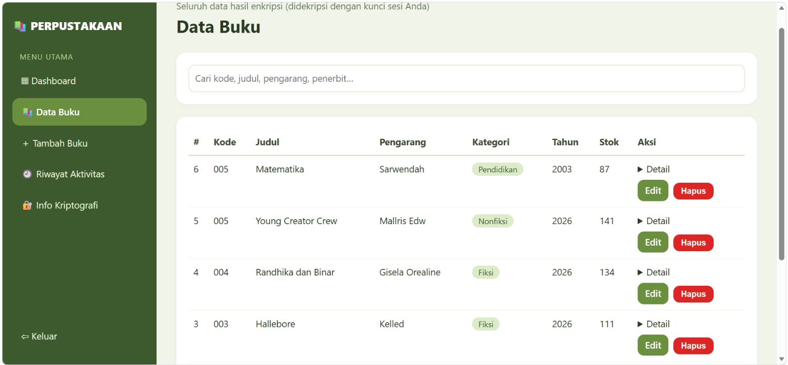
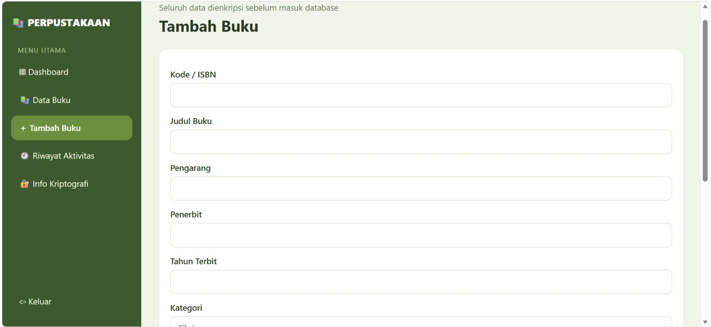
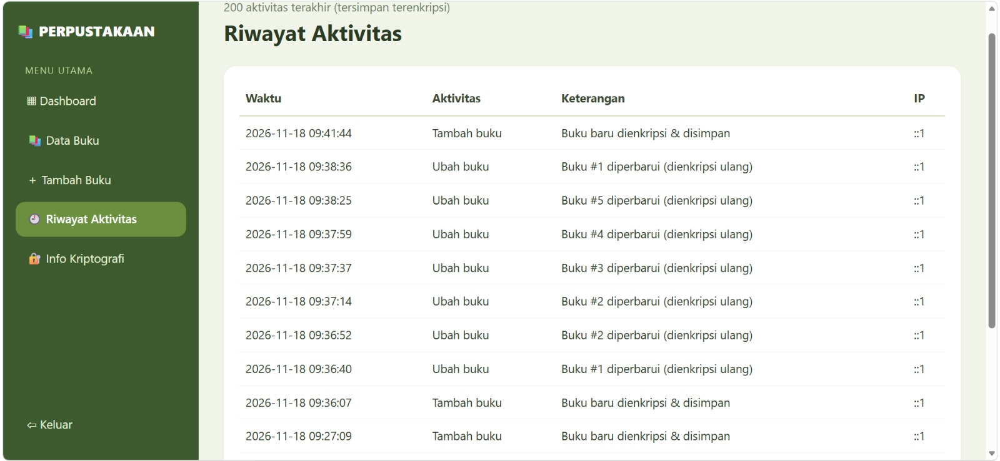

# Sistem Informasi Perpustakaan – Kriptografi Simetris & Asimetris (PHP)

Aplikasi data buku perpustakaan. Seluruh konten halaman admin disimpan terenkripsi.
Akses admin memakai **RSA private key** (kunci asimetris). Kunci simetris dipegang server (`storage/master.key.php`).

- **Kunci benar** → semua data tampil sebagai teks asli, tambah/ubah/hapus aktif.
- **Kunci salah atau kosong** → tetap bisa masuk, tetapi mode hanya-lihat: seluruh teks tampil sebagai **ciphertext** dan tambah/ubah/hapus dinonaktifkan.

## Fitur
Dashboard · Data Buku (cari, detail + ciphertext, edit, hapus) · Tambah Buku · Riwayat Aktivitas (terenkripsi) · Info Kriptografi

## Kebutuhan
PHP 8.1+ (ekstensi openssl, pdo_mysql) dan MySQL/MariaDB (mis. Laragon/XAMPP).
Alternatif tanpa MySQL: ubah `driver` di `config.php` menjadi `sqlite` (ekstensi pdo_sqlite).

## Instalasi (Laragon)
1. Ekstrak ke `C:\laragon\www\perpustakaan`
2. Import database: `perpustakaan.sql` (HeidiSQL: File > Load SQL file > F9)
3. Cek `config.php` (default root, tanpa password)
4. Buka `http://localhost/perpustakaan` → **Setup** (unduh/simpan `private.pem`) → login dengan menempelkan private key

> **Penting:** simpan `private.pem` dan cadangkan `storage/master.key.php`. Server tidak menyimpan private key,
> dan tanpa kedua berkas itu data yang sudah terenkripsi tidak bisa dipulihkan.

## Skema Kriptografi
```
plaintext --AES-256-GCM(DEK acak)--------------------> data
DEK       --RSA-3072 OAEP(public key)----------------> wrapped
wrapped   --AES-256-GCM(KEK = kunci simetris server)--> lock_data
```

## Struktur Proyek
```
perpustakaan/
├─ index.php  setup.php  logout.php          halaman publik (login, setup, keluar)
├─ dashboard.php  buku.php  tambah.php       halaman admin
│  edit.php  riwayat.php  info.php
├─ config.php                                 koneksi database
├─ perpustakaan.sql                           skema database (MySQL)
├─ lib/
│  ├─ app.php            sesi, database, helper, layout halaman publik
│  ├─ crypto.php         AES-256-GCM + RSA-OAEP (seal / unseal)
│  ├─ admin_layout.php   sidebar & banner mode terkunci
│  ├─ cipherize.php      pengacak teks → ciphertext (mode terkunci)
│  └─ book_form.php      form & validasi data buku
├─ assets/               app.css (publik), admin.css (admin)
├─ images/               screenshot dokumentasi
└─ storage/              master.key.php (dibuat saat setup, tidak di-commit)
```

## Struktur Database (`perpustakaan.sql`)
`settings`, `buku`, `riwayat`. Tabel `buku` dan `riwayat` hanya berisi `data` dan `lock_data` (ciphertext).

## Tampilan (Mode Terbuka / Plaintext)
| Dashboard | Data Buku |
|---|---|
|  |  |
| **Tambah Buku** | **Riwayat Aktivitas** |
|  |  |

## Tampilan (Mode Terkunci / Ciphertext)
| Dashboard (Ciphertext) | Data Buku (Ciphertext) |
|---|---|
|  |  |
| **Riwayat Aktivitas (Ciphertext)** | **Info Kriptografi (Ciphertext)** |
|  |  |

## Link Kode Program
[https://github.com/rismagistiani8-png/perpustakaan-app](https://github.com/rismagistiani8-png/perpustakaan-app)